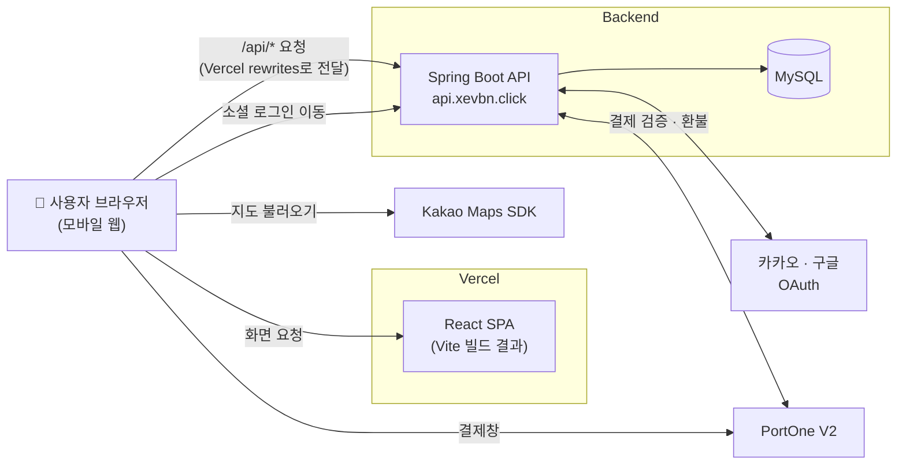

<div align="center">


# 놀이동선 (Frontend)

**놀이공원 어트랙션 예약 · 최적 루트 추천 서비스의 프론트엔드 저장소입니다.**

[서비스 바로가기](https://attraction-reservation-frontend.vercel.app/) · [백엔드 저장소](https://github.com/attraction-final/attraction-reservation)

</div>

---

## 📌 목차

1. [프로젝트 소개](#-프로젝트-소개)
2. [주요 기능](#-주요-기능)
3. [기술 스택](#-기술-스택)
4. [아키텍처](#-아키텍처)
5. [프론트 담당](#team)
6. [상세 문서](#-상세-문서)
7. [실행 방법](#-실행-방법)

---

## 🎢 프로젝트 소개

놀이공원에서는 인기 어트랙션의 긴 대기 시간, 예약 경쟁, 복잡한 이동 동선 때문에 원하는 만큼 즐기지 못하는 경우가 많습니다.

**놀이동선**은 에버랜드를 기반으로, 방문객이 타고 싶은 어트랙션을 고르면 **현재 위치와 이동 거리를 고려한 방문 순서를 추천**하고, **시간대별 슬롯 예약**까지 한 번에 할 수 있도록 만든 서비스입니다.

| 항목 | 내용 |
|---|---|
| 프로젝트 기간 | 5주 |
| 주요 사용자 | 놀이공원 방문객 |
| 주요 관리자 | 어트랙션 · 운영 일정 · 예약 현황을 관리하는 운영자 |
| 화면 특징 | PC에서는 휴대폰 틀 안에 보이고, 휴대폰에서는 화면을 꽉 채우는 모바일 웹입니다. |

> 이 저장소는 **화면(프론트엔드)** 만 담고 있습니다. 서버(API)는 [백엔드 저장소](https://github.com/attraction-final/attraction-reservation)에 있습니다.

---

## ✨ 주요 기능

### 방문객

| 기능 | 설명 |
|---|---|
| 회원가입 · 로그인 | 이메일 회원가입과 **카카오 · 구글 소셜 로그인**을 지원합니다. 로그인은 JWT(Access Token + Refresh Token 쿠키) 방식입니다. |
| 입장권 구매 | 방문 날짜와 입장권을 고른 뒤 **포트원(PortOne) V2** 결제창으로 결제합니다. |
| 내 입장권 · 환불 | 구매한 입장권을 **QR 코드**로 보여 주고, 입장권 한 장 단위로 환불을 요청할 수 있습니다. |
| 어트랙션 조회 | 운영 중인 어트랙션 목록과 상세 정보를 확인합니다. |
| 슬롯 예약 | 어트랙션마다 정해진 **시간대(슬롯)** 를 골라 예약합니다. 내 다른 예약과 시간이 겹치면 화면에 표시됩니다. |
| 루트 추천 | **카카오맵** 위의 어트랙션 핀(또는 목록)에서 5개를 고르면, 현재 위치에서 출발해 **걷는 시간이 가장 짧은 방문 순서**를 추천합니다. 지도에는 내 위치와 어트랙션까지의 예상 도보 시간이 표시됩니다. |
| 어트랙션 질문 | 어트랙션에 대해 채팅처럼 질문하고 답변을 받습니다. |
| 내 예약 · 마이페이지 | 예약 내역 확인 · 취소, 닉네임 · 비밀번호 변경, 회원 탈퇴를 할 수 있습니다. |

### 관리자

| 기능 | 설명 |
|---|---|
| 어트랙션 · 슬롯 관리 | 어트랙션 등록 · 수정 · 삭제, 운영 상태 변경, 슬롯 추가(15분 간격 일괄 생성) · 시간 · 정원 변경을 합니다. |
| 예약 관리 | 전체 예약을 조회하고 상태를 변경하거나 취소합니다. |
| 회원 관리 | 회원 목록을 조회하고 회원 상태를 변경합니다. |
| 입장권 상품 · 주문 관리 | 입장권 상품을 등록 · 수정하고, 주문 조회와 전체 · 부분 환불을 처리합니다. |
| 입장 처리 | 휴대폰 카메라로 입장권 **QR 코드를 읽어** 입장 완료로 바꿉니다. |

---

## 🛠 기술 스택

### Frontend (이 저장소)

| 구분 | 기술 | 버전 (`package.json` 기준) |
|---|---|---|
| 언어 · 라이브러리 | React / React DOM | ^18.3.1 |
| 라우팅 | React Router | ^6.26.2 |
| 빌드 도구 | Vite | ^5.4.8 |
| 결제 | @portone/browser-sdk (PortOne V2) | ^0.1.13 |
| QR 생성 | qrcode.react | ^4.2.0 |
| QR 인식 | @zxing/browser, @zxing/library | ^0.2.1, ^0.23.0 |
| 지도 | Kakao Maps JavaScript SDK | - (스크립트로 불러옵니다) |
| 배포 | Vercel | - |

### 외부 연동

| 서비스 | 쓰는 곳 |
|---|---|
| Kakao Maps API | 루트 추천 화면의 지도 |
| 카카오 · 구글 OAuth | 소셜 로그인 (백엔드가 처리합니다) |
| PortOne V2 | 입장권 결제 · 환불 |

### Backend

Spring Boot 기반이며, 자세한 기술 스택은 [백엔드 저장소 README](https://github.com/attraction-final/attraction-reservation)를 참고해 주세요.

---

## 🏗 아키텍처

<!-- 아키텍처 PNG 이미지가 준비되면 docs/images/architecture.png 로 넣고 아래 줄의 주석을 풀어 주세요. -->
<!--  -->



- **화면**은 Vercel에서 내려받습니다.
- **`/api/*` 요청**은 `vercel.json` 의 `rewrites` 설정으로 백엔드(`https://api.xevbn.click`)에 전달됩니다. 그래서 브라우저 입장에서는 같은 주소로 요청하는 것처럼 보입니다.
- **소셜 로그인**은 페이지 전체가 이동하는 방식이라, 백엔드 주소(`VITE_OAUTH_BASE_URL`)로 직접 이동합니다.
- **결제**는 브라우저에서 포트원 결제창을 띄우고, 결제가 끝나면 백엔드가 포트원에 금액을 다시 확인한 뒤 주문을 확정합니다.

---

<a id="team"></a>
## 👥 프론트 담당

| 항목 | 내용 |
|---|---|
| 이름 | 이윤지 |

---

## 📚 상세 문서

| 문서 | 설명 |
|---|---|
| [프론트엔드 개발 가이드](https://github.com/attraction-final/attraction-reservation-frontend/blob/main/DEVELOPMENT.md) | 폴더 구조, 화면 ↔ 주소, 환경 변수, 데이터 흐름, 배포 시 주의할 점을 정리한 문서입니다. |
| [백엔드 저장소](https://github.com/attraction-final/attraction-reservation) | Spring Boot API 서버 코드입니다. |
| [API 명세서](https://github.com/attraction-final/attraction-reservation-frontend/blob/main/docs/api.md) | 프론트엔드 코드가 실제로 부르는 API(src/api/index.js 기준 목록) 입니다. |
| [ERD](https://github.com/attraction-final/attraction-reservation-frontend/blob/main/docs/images/erd.png) | 전체 테이블 구조입니다. |
| [기획안](https://app.notion.com/p/teamsparta/3f82dc3ef51480478333f70f5f2dbd57) | 기획 배경, 문제 정의, 비즈니스 규칙입니다. |

---

## 🚀 실행 방법

**준비물**
- [Node.js](https://nodejs.org) 18 이상 (LTS 버전을 추천합니다)
- 스프링부트 백엔드가 `localhost:8080` 에서 실행 중이어야 합니다. (가짜 데이터가 없어서 백엔드 없이는 데이터가 보이지 않습니다)

```bash
npm install      # 처음 한 번만: 필요한 라이브러리를 내려받습니다
npm run dev      # 개발 서버 실행 → http://localhost:5173
```

**카카오맵 키 설정**

루트 추천 지도를 보려면 프로젝트 최상위에 `.env.local` 파일을 만들고 아래 한 줄을 적습니다.

```bash
VITE_KAKAO_MAP_APP_KEY=카카오_JavaScript_키
```

- 키는 [카카오 개발자 콘솔](https://developers.kakao.com) → 내 애플리케이션 → 앱 키 → **JavaScript 키**입니다.
- 같은 앱의 **[플랫폼 → Web]** 에 `http://localhost:5173` (배포 시에는 배포 주소)를 등록해야 지도가 열립니다.
- `.env.local` 은 `.gitignore` 에 포함되어 있어 깃에 올라가지 않습니다.
- 키를 비워 두면 카카오맵 대신 **간이 지도**(좌표대로 핀만 찍은 지도)가 표시됩니다.

환경 변수 전체 목록과 배포 설정은 [프론트엔드 개발 가이드](DEVELOPMENT.md)를 참고해 주세요.
